

# isilicon

I build things that fail closed.

https://huggingface.co/isilicon
https://pirateface.co/isilicon

 

## Interests

- Embedded and hardware security (bootloaders, authenticators, constrained devices)
- Red teaming, LLM jailbreaking, and AI security research
- Agent tooling and computer-use agents
- ML training, distillation, and efficiency
- Multi-device audio systems

## Live demos

<table>
<tr>
<td width="50%" align="center">
<a href="https://github.com/isiliconx/spacebunny"><strong>spacebunny</strong></a> 
<a href="https://isiliconx.github.io/spacebunny/">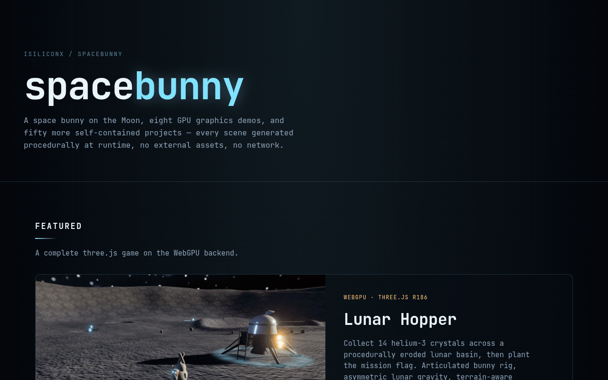</a> 
WebGPU three.js site · fifty offline graphics demos
</td>
<td width="50%" align="center">
<a href="https://github.com/isiliconx/spacebunny"><strong>neon plankton demo</strong></a> 
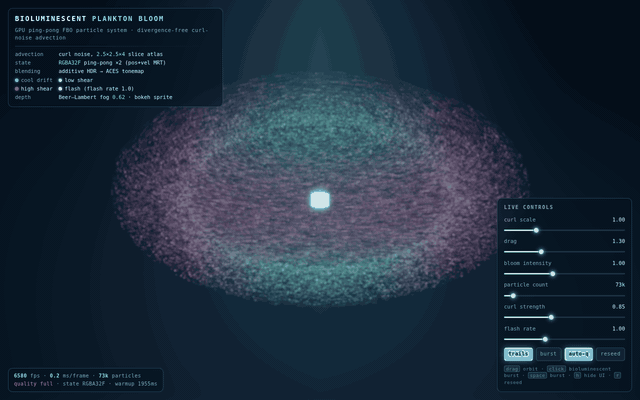 
73k GPU particles · curl-noise advection · WebGL2
</td>
</tr>
<tr>
<td width="50%" align="center">
<a href="https://github.com/isiliconx/nextdrop"><strong>nextdrop</strong></a> 
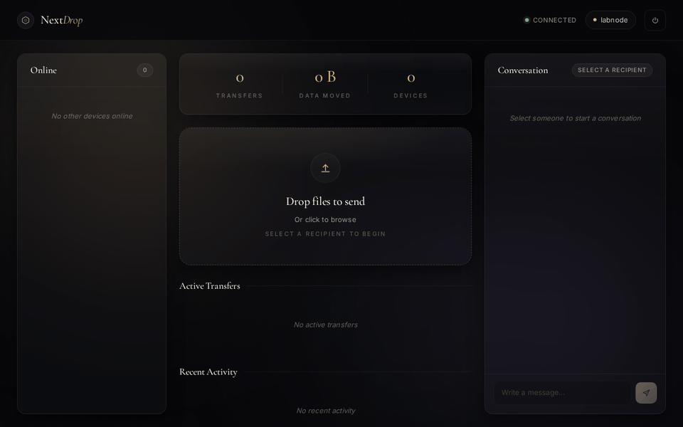 
Zero-storage LAN file transfer over authenticated Socket.IO
</td>
<td width="50%" align="center">
<strong>Quintet Director</strong> 
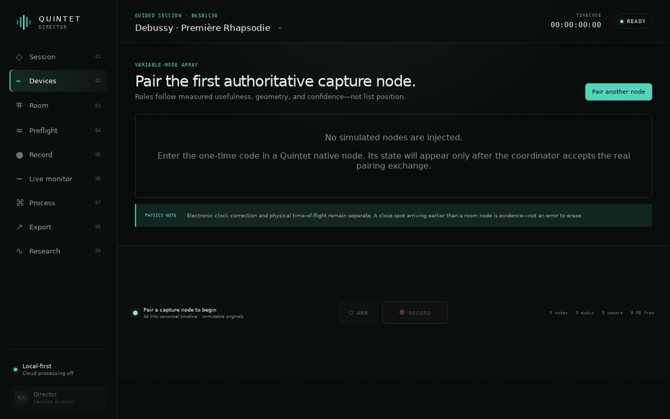 
Multi-device computational mic array · source private
</td>
</tr>
<tr>
<td width="50%" align="center">
<strong>Storo</strong> 
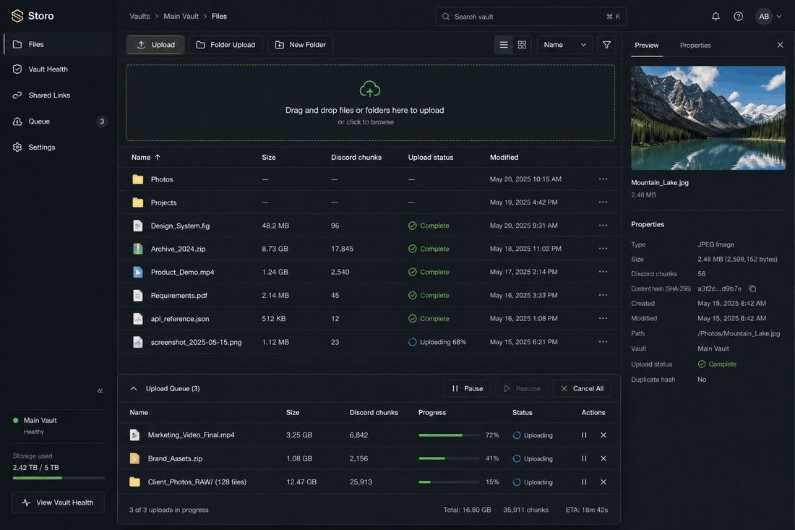 
E2E encrypted personal cloud · PWA / desktop / mobile
</td>
<td width="50%" align="center">
<a href="https://github.com/isiliconx/hardwarekeyemulator"><strong>hardwarekeyemulator</strong></a> 
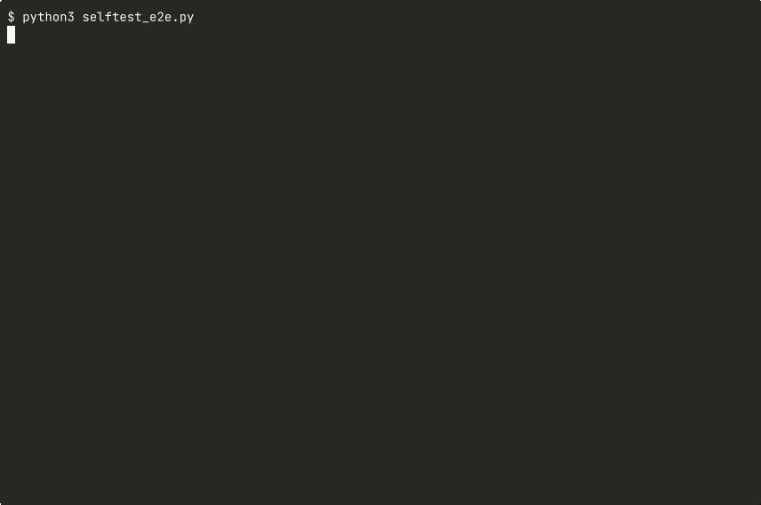 
Lab CTAP2 / FIDO2 software authenticator · selftests green
</td>
</tr>
<tr>
<td width="50%" align="center">
<a href="https://github.com/isiliconx/infinity-codex-releases"><strong>Infinity</strong></a> 
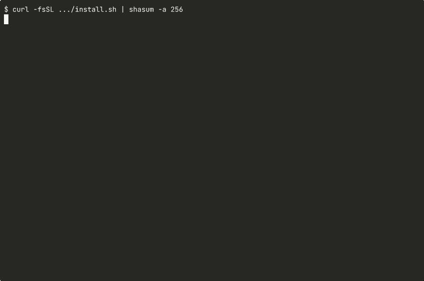 
Verified install · checksums · CLI help
</td>
<td width="50%" align="center">
<strong>Infinite</strong> 
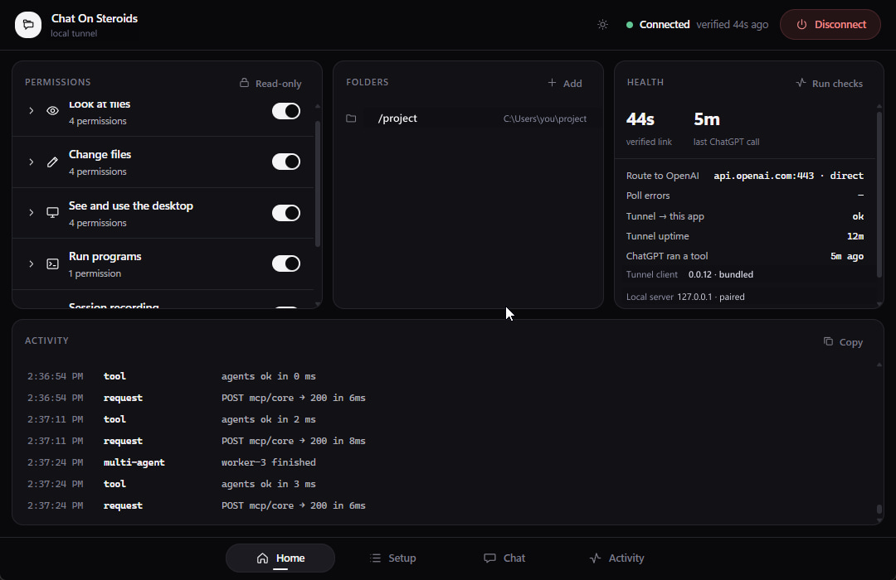 
Cross-platform MCP bridge for browser AI hosts
</td>
</tr>
</table>

## Selected work

| Project | What it is |
| --- | --- |
| [hardwarekeyemulator](https://github.com/isiliconx/hardwarekeyemulator) | Lab CTAP2 / FIDO2 software authenticator with CTAPHID, Linux UHID transport, and a local WebAuthn RP |
| [hardwarekeyemulator-audit](https://github.com/isiliconx/hardwarekeyemulator-audit) | Security audit of the emulator: critical UV forge, AAGUID defect, remediations, and a differential that proves closures |
| [the-byte-of-87](https://github.com/isiliconx/the-byte-of-87) | Secure embedded design challenge (MITRE eCTF style): ChaCha20-Poly1305 + Ed25519 bootloader and update path on Tiva |
| [spacebunny](https://github.com/isiliconx/spacebunny) | WebGPU three.js site plus fifty offline self-contained graphics / simulation demos |
| [nextdrop](https://github.com/isiliconx/nextdrop) | Zero-storage LAN file transfer portal over authenticated Socket.IO; files relay in memory only |
| [infinity-codex-releases](https://github.com/isiliconx/infinity-codex-releases) | Verified Infinity binaries, installers, checksums, and offline USB bundles |

### the-byte-of-87 · secure boot / update

Two-pass update: Ed25519 over the header and ciphertext first, then ChaCha20-Poly1305 decrypt and tag check. Commit magic is `BOOT_MAGIC ^ diff` so a failed check cannot produce a bootable record. A monotone `min_ver` ratchet on its own flash page blocks rollback. Boot itself is crypto-free; the magic is the proof.

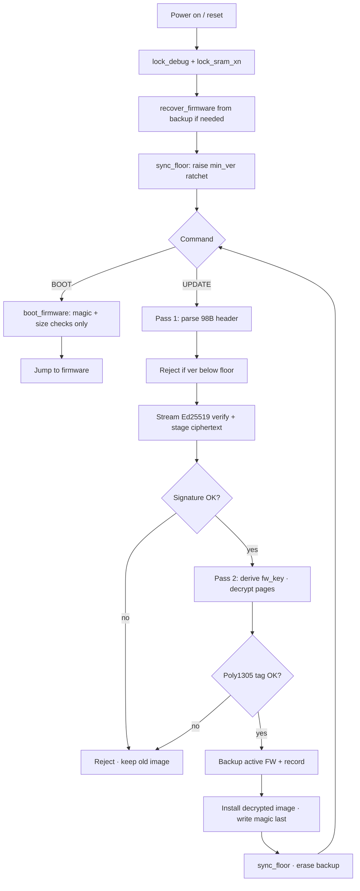

## Private projects

Source private; demos available on request.

<strong>Quintet</strong> · multi-device computational mic array

 

Phones, laptops, and tablets as coordinated capture nodes with AI-driven placement and mixing (TypeScript / Rust / Swift). Director control surface, local coordinator, signed native pairing, and provenance-backed processing graphs.

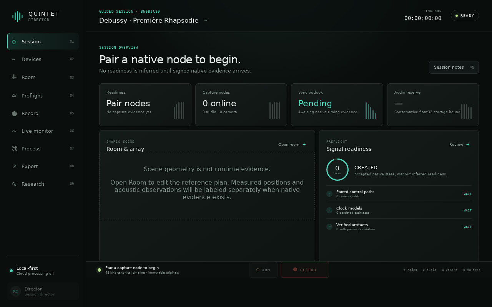

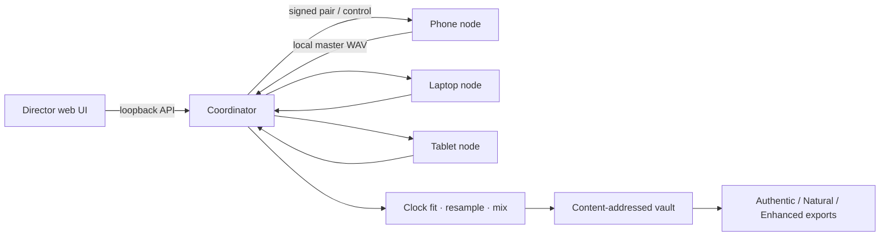

source private; demos on request

<strong>Infinity</strong> · MCP computer-use agent

 

MCP computer-use agent across files, shell, browser, and desktop. Verified binaries, installers, and USB bundles at [infinity-codex-releases](https://github.com/isiliconx/infinity-codex-releases).

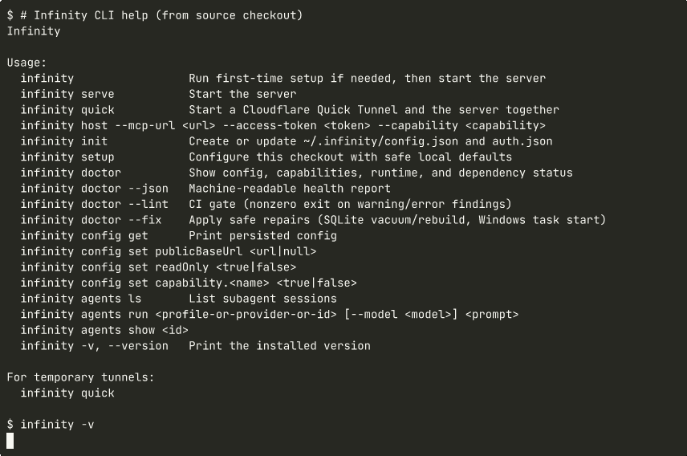

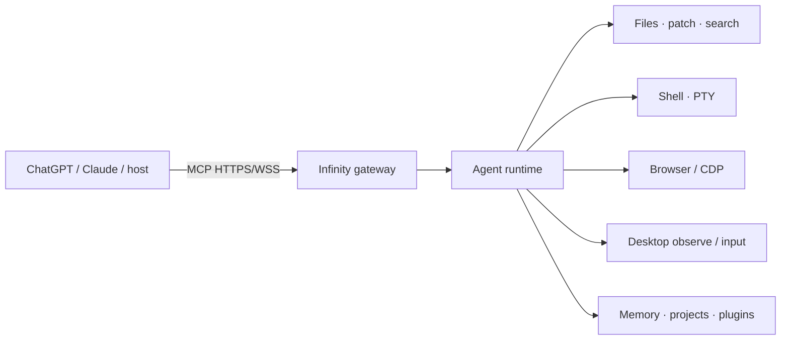

source private; demos on request

<strong>Storo</strong> · encrypted personal cloud

 

End-to-end encrypted personal cloud storage with PWA, desktop, and mobile clients. Chunked uploads, resumable queue, previews, sharing, and vault health.

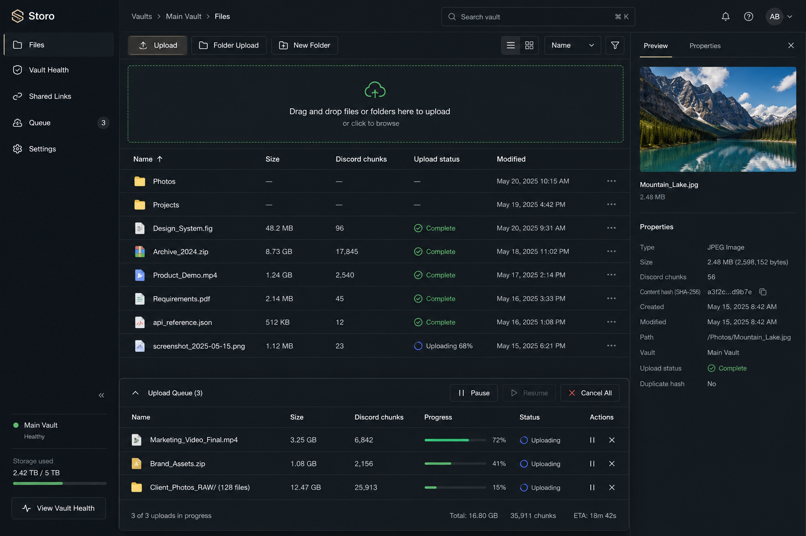

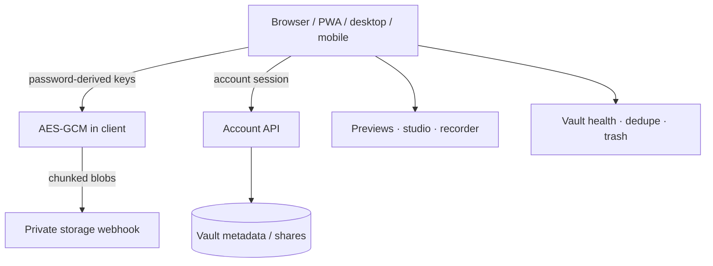

source private; demos on request

<strong>Infinite</strong> · MCP bridge desktop app

 

Cross-platform MCP bridge desktop app: a local permission boundary for browser AI hosts (files, shell, desktop, and companion extension).

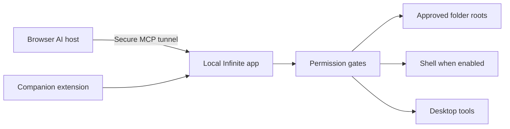

source private; demos on request

## Stats

