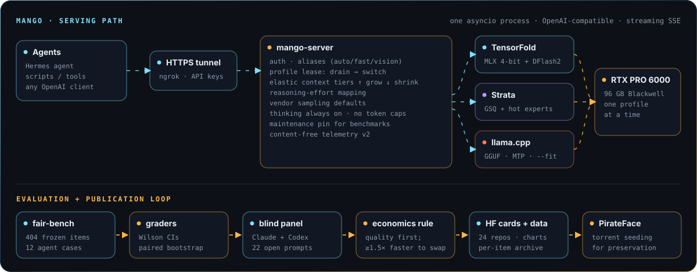
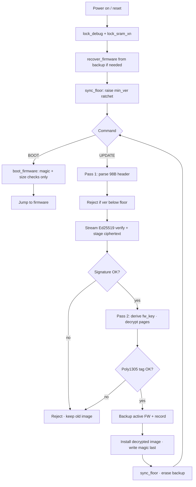
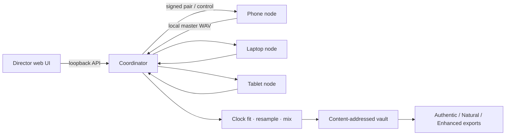
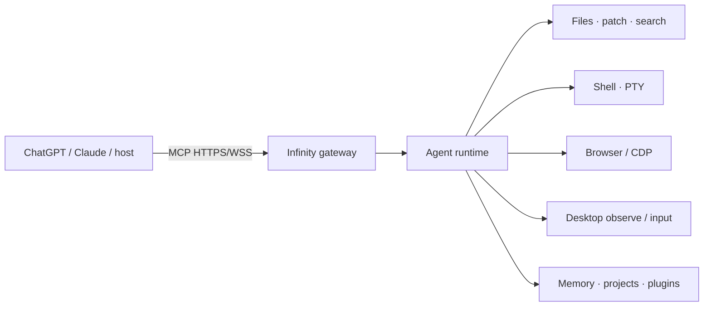
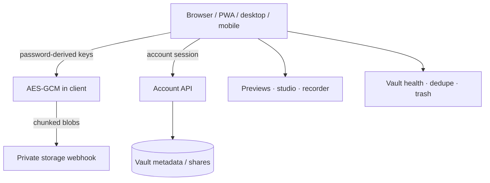
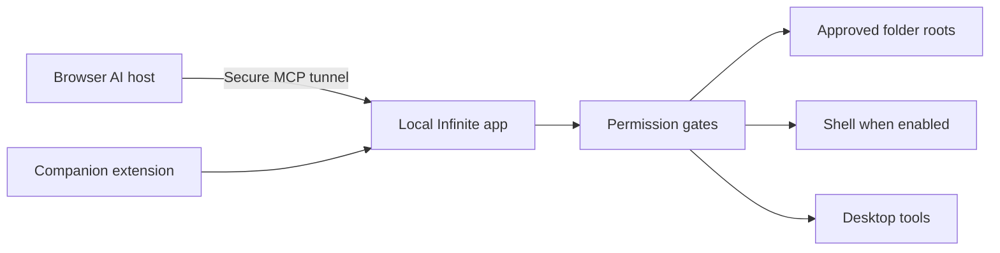

 

## Now: Mango, a self-hosted LLM lab

One 96 GB RTX PRO 6000 serving a fleet of open-weight models to my own agents through an
OpenAI-compatible API, with every model measured on the same frozen benchmark before it gets a route.
The fleet uses uncensored / refusal-edited checkpoints, and they have to win on measured quality
and speed like anything else.

**What's interesting about it**

- **mango-server**: one asyncio process replacing a chain of three blocking proxies. Profiles lease the GPU one
  at a time (drain → switch), context windows grow and shrink by tier per request, and `reasoning_effort` maps to
  each engine's real levels. Thinking is always on and no token cap is imposed beyond the context window.
- **Three engines, one card**: TensorFold (MLX 4-bit + DFlash2 speculative drafter), Strata (GSQ quantized
  MoE with hot-expert GPU placement) and pinned llama.cpp builds (GGUF, MTP heads, `--fit` CPU offload for big MoEs).
- **fair-bench**: 404 frozen items weighted to what I actually use (human understanding, coding + cybersecurity,
  agentic work), 12 offline agent cases with injected malicious instructions, and a 22-prompt open-ended suite.
  The graders report Wilson intervals, paired bootstrap differences and an economics rule: a faster model only
  displaces a better one if it is within 3 points and at least 1.5× faster.
- **Blind panel**: Claude and Codex each freeze their ratings before the identity key is opened, and the two are averaged.
- **Wipe-proof**: the GPU host is ephemeral. Results checkpoint continuously, downloads are hash-pinned, and a
  one-cell recovery rebuilds runtime, weights and queue on a fresh host without rerunning finished work.

<strong>Domain breakdown</strong> · where each model is strong

 

**What the numbers say so far**

- Flash Next IQ4_XS leads at 84.19 in 35 workload minutes and is the default under the economics rule.
  Qwen3.8 27B on MLX 4-bit finishes the same screen in 24 minutes at 80.64, which keeps it on the Pareto frontier
  as the fast resident model.
- Size didn't decide the order: Qwen3.5 122B (80.72) took 5× longer than the 27B for the same score, and
  MiMo V2.6 needed 220 minutes.
- Cyber-specialist Qwen 27B fine-tunes did *not* beat the general model on cyber here, and lost 26–31 points
  on social/EQ. Different lineages and draft heads mean that's a finding about those builds, not about quantization.
- Effort study on the 27B (full 403 valid items): xhigh 84.41 vs medium 82.87, paired 95% CI −1.71 to +4.82,
  at 4.46× the time, so medium stays the default. The blind panel gave 8.18 vs 7.77 out of 10.

<strong>Public model repos</strong> · exact quants with test results on every card

 

| Repo | What |
| --- | --- |
| [mango-qwen38-flashnext-iq4xs](https://huggingface.co/isilicon/mango-qwen38-flashnext-iq4xs) | Current leader · 84.19 |
| [mango-flashnext-orca-iq4xs-20261029](https://huggingface.co/isilicon/mango-flashnext-orca-iq4xs-20261029) | Flash Next, Orca build · 83.42 |
| [mango-deepseek41-gsq-iq2xs-uncensored](https://huggingface.co/isilicon/mango-deepseek41-gsq-iq2xs-uncensored) | DeepSeek V4.1 Flash, GSQ IQ2_XS for Strata · 83.19 |
| [mango-qwen38-27b-uncensored-mlx4](https://huggingface.co/isilicon/mango-qwen38-27b-uncensored-mlx4) | Fast resident model + effort study · 80.64 |
| [mango-qwen38-27b-gguf](https://huggingface.co/isilicon/mango-qwen38-27b-gguf) | 8 GGUF quants (Q2 to Q6) in one repo, general and Cyber lineages kept separate |
| [mango-qwen35-122b-q4](https://huggingface.co/isilicon/mango-qwen35-122b-q4) | Qwen3.5 122B A10B · 80.72 |
| [mango-mimo26-flash-mopd-uncensored-q3km](https://huggingface.co/isilicon/mango-mimo26-flash-mopd-uncensored-q3km) | MiMo V2.6 Flash · 79.39 |
| [mango-dflash2](https://huggingface.co/isilicon/mango-dflash2) | DFlash2 speculative drafter |

Everything else (GLM 5.3 Flash builds, Nanbeige, Cyber variants, drafters, tokenizers, queued candidates) is in the
[collection](https://huggingface.co/collections/isilicon/mango-tested-models-and-preservation-mirrors).
Every mirror keeps the original publisher's card, license and attribution. Torrents for preservation are on
[PirateFace](https://pirateface.co/isilicon).

## Interests

- Self-hosted inference: quantization, speculative decoding, MoE offload, serving many models from one GPU
- Model evaluation that holds up: frozen suites, paired statistics, blind grading
- Embedded and hardware security (bootloaders, authenticators, constrained devices)
- Red teaming, LLM jailbreaking, and AI security research
- Agent tooling and computer-use agents
- ML training, distillation, and efficiency

## Live demos

<table>
<tr>
<td width="50%" align="center">
<a href="https://github.com/isiliconx/spacebunny"><strong>spacebunny</strong></a> 
 
WebGPU three.js site · fifty offline graphics demos
</td>
<td width="50%" align="center">
<a href="https://github.com/isiliconx/spacebunny"><strong>neon plankton demo</strong></a> 
 
73k GPU particles · curl-noise advection · WebGL2
</td>
</tr>
<tr>
<td width="50%" align="center">
<a href="https://github.com/isiliconx/nextdrop"><strong>nextdrop</strong></a> 
 
Zero-storage LAN file transfer over authenticated Socket.IO
</td>
<td width="50%" align="center">
<strong>Quintet Director</strong> 
 
Multi-device computational mic array · source private
</td>
</tr>
<tr>
<td width="50%" align="center">
<strong>Storo</strong> 
 
E2E encrypted personal cloud · PWA / desktop / mobile
</td>
<td width="50%" align="center">
<a href="https://github.com/isiliconx/hardwarekeyemulator"><strong>hardwarekeyemulator</strong></a> 
 
Lab CTAP2 / FIDO2 software authenticator · selftests green
</td>
</tr>
<tr>
<td width="50%" align="center">
<a href="https://github.com/isiliconx/infinity-codex-releases"><strong>Infinity</strong></a> 
 
Verified install · checksums · CLI help
</td>
<td width="50%" align="center">
<strong>Infinite</strong> 
 
Cross-platform MCP bridge for browser AI hosts
</td>
</tr>
</table>

## Selected work

| Project | What it is |
| --- | --- |
| [Mango on Hugging Face](https://huggingface.co/isilicon) | Self-hosted LLM fleet: 24 public model repos with exact-quant test results, charts and runtime guides |
| [hardwarekeyemulator](https://github.com/isiliconx/hardwarekeyemulator) | Lab CTAP2 / FIDO2 software authenticator with CTAPHID, Linux UHID transport, and a local WebAuthn RP |
| [hardwarekeyemulator-audit](https://github.com/isiliconx/hardwarekeyemulator-audit) | Security audit of the emulator: critical UV forge, AAGUID defect, remediations, and a differential that proves closures |
| [the-byte-of-87](https://github.com/isiliconx/the-byte-of-87) | Secure embedded design challenge (MITRE eCTF style): ChaCha20-Poly1305 + Ed25519 bootloader and update path on Tiva |
| [spacebunny](https://github.com/isiliconx/spacebunny) | WebGPU three.js site plus fifty offline self-contained graphics / simulation demos |
| [nextdrop](https://github.com/isiliconx/nextdrop) | Zero-storage LAN file transfer portal over authenticated Socket.IO; files relay in memory only |
| [infinity-codex-releases](https://github.com/isiliconx/infinity-codex-releases) | Verified Infinity binaries, installers, checksums, and offline USB bundles |

### the-byte-of-87 · secure boot / update

Two-pass update: Ed25519 over the header and ciphertext first, then ChaCha20-Poly1305 decrypt and tag check. Commit magic is `BOOT_MAGIC ^ diff` so a failed check cannot produce a bootable record. A monotone `min_ver` ratchet on its own flash page blocks rollback. Boot itself is crypto-free; the magic is the proof.

## Private projects

Source private; demos available on request.

<strong>Quintet</strong> · multi-device computational mic array

 

Phones, laptops, and tablets as coordinated capture nodes with AI-driven placement and mixing (TypeScript / Rust / Swift). Director control surface, local coordinator, signed native pairing, and provenance-backed processing graphs.

source private; demos on request

<strong>Infinity</strong> · MCP computer-use agent

 

MCP computer-use agent across files, shell, browser, and desktop. Verified binaries, installers, and USB bundles at [infinity-codex-releases](https://github.com/isiliconx/infinity-codex-releases).

source private; demos on request

<strong>Storo</strong> · encrypted personal cloud

 

End-to-end encrypted personal cloud storage with PWA, desktop, and mobile clients. Chunked uploads, resumable queue, previews, sharing, and vault health.

source private; demos on request

<strong>Infinite</strong> · MCP bridge desktop app

 

Cross-platform MCP bridge desktop app: a local permission boundary for browser AI hosts (files, shell, desktop, and companion extension).

source private; demos on request

## Stats

